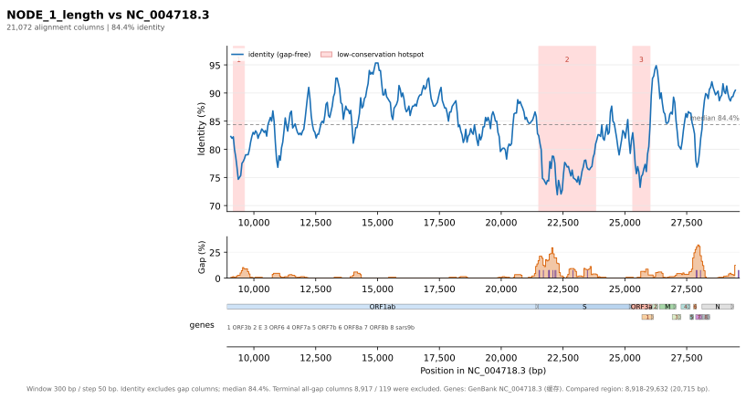

# align-conservation-plot

[中文](README_zh.md) | **English**

Turn an alignment into a publication-ready figure with a sliding-window identity
curve, a gap-density track and a gene map. Exports **SVG / PDF / PNG**.
Supports EMBOSS `srspair` / `pair` as well as common multiple-sequence alignment
formats, and ships with a Tkinter GUI.



## Why write another tool

Every existing tool is missing one piece:

| Tool | What it does | What is missing |
|---|---|---|
| EMBOSS `plotcon` | Sliding-window conservation curve, can write pdf/svg | Plots substitution-matrix similarity, not identity %; no gap track, no indel markers, no gene track |
| MSAexplorer | MSA analysis, reads gb/gff/bed, exports PDF | No sliding identity + gap-density curve against a reference coordinate system; PDF only |
| pyMSAviz / MSAplot | MSA colour blocks + seqlogo | No sliding identity curve |
| Jalview | Per-column conservation colouring | Not a genome-coordinate sliding window plot |
| dna_features_viewer | Gene track | Track only |

There is also no dedicated visualizer for the `srspair` format (a GitHub-wide
search only turns up a datatype declaration in janis-core).

## Installation

```bash
cd tools/alignment-conservation-plot
./setup.sh
```

The script prefers `/opt/homebrew/bin/python3.14` (which bundles Tk 9.1),
creates a `.venv` and installs `matplotlib` and `biopython`. Behind a proxy:

```bash
http_proxy=http://127.0.0.1:8080 https_proxy=http://127.0.0.1:8080 ./setup.sh
```

## Command line

```bash
./.venv/bin/python align_conservation_plot.py \
    -i "examples/sars-cov-2-assembled-contig-vs-sars-cov.srspair" \
    -o figure.svg --pdf \
    --coords-seq 2 --window 300 --step 50 \
    --annotation NC_004718.3 \
    --title "SARS-CoV-2 contig vs SARS-CoV (NC_004718.3)"
```

Output:

```
figure.svg
figure.pdf
```

The table language used by `--hotspot-table-md` and `--pdf-with-table` also
follows `--lang`.

### Common options

| Option | Default | Description |
|---|---|---|
| `-i, --input` | required | Alignment file (`.gz` is fine) |
| `-o, --out` | `<input>_conservation.svg` | SVG output path |
| `--pdf [PATH]` | off | Also write a PDF |
| `--png [PATH]` | off | Also write a PNG (`--dpi` controls resolution) |
| `--coords-seq` | `1` | Which sequence provides the coordinate axis (1-based). Usually `2` when aligning to a reference genome |
| `--window` / `--step` | `300` / `50` | Window size and step (bp) |
| `--annotation` | none | Annotation file path, **or an NCBI accession such as `NC_004718.3`** |
| `--annotation-timeout` | `60` | Online download timeout (seconds) |
| `--no-annotation-cache` | off | Neither read nor write the download cache |
| `--refresh-annotation` | off | Ignore the cache and download again |
| `--annotation-format` | auto | `genbank` / `gff3` / `tsv` |
| `--record` | first | Record id when a GenBank file holds several records |
| `--min-orf-aa` | `90` | Minimum amino-acid length for predicted ORFs |
| `--indel-min` | `8` | Only report indels at least this long |
| `--hotspot-k` | `1.5` | Hotspot threshold = median − k × 1.4826 × MAD |
| `--hotspot-pct` | empty | Use a percentile threshold instead (takes precedence over `--hotspot-k`) |
| `--keep-terminal-gaps` | off | Keep terminal all-gap columns (trimmed by default) |
| `--lang` | `en` | Figure text language; `zh` switches to PingFang SC |
| `--stats-out` | none | Write the per-window statistics TSV |
| `--summary-out` | none | Write a JSON summary |
| `--hotspot-table-md` | none | Write the low-conservation table as Markdown |
| `--pdf-with-table` | off | Append the hotspot table pages to the PDF (figure stays on page 1) |
| `--figsize W H` | automatic | Figure size in inches |
| `--gui` | — | Launch the graphical interface |

## Graphical interface

```bash
./.venv/bin/python align_conservation_plot.py --gui
# or double-click run_gui.command
```

- Parameters on the left, live preview on the right.
- The "annotation file or accession" field accepts `NC_004718.3` directly and
  downloads it (with caching).
- The right pane has **Figure / Table** tabs; the table is the low-conservation
  overview whose indices match the numbered hotspots in the figure.
- Computation runs on a background thread, so the window stays responsive.
- Exports re-render at the standard figure size, so the output does not depend
  on how large the preview window happens to be.

### Low-conservation table

Columns: `#`, `Coordinates (bp)`, `Length (bp)`, `Identity % (ungapped)`,
`Identity % (with gaps)`, `Indel %`, `Region`.

- Indices match the hotspot numbers in the figure exactly; the figure numbers
  **every** hotspot.
- `Region` is the annotated feature with the largest overlap; a second feature
  is appended as `A / B` when it covers at least 20% of the hotspot. Without
  annotation it shows `—`.
- `Indel %` reports two numbers: `gap-column share / share covered by indels at
  or above the threshold`, for example `3.7 / 0.0`.

### Batch export

Tick the items under "Export", press "Export selected…", choose a folder once,
and every artefact is written with the input file name as prefix:

| Selection | Output |
|---|---|
| Data (TSV / JSON) | `<stem>_windows.tsv` or `<stem>_summary.json` |
| Figure SVG | `<stem>_conservation.svg` |
| Figure PNG (DPI 72–1200) | `<stem>_conservation.png` |
| Hotspot table Markdown | `<stem>_hotspots.md` |
| PDF → figure | `<stem>_conservation.pdf`, page 1 |
| PDF → table | the same PDF, from page 2 (extra pages when needed) |

The PDF figure and table can both be selected: the result is one file with the
figure on page 1 and the table from page 2. Table only starts on page 1.

### Interface and figure language

The interface starts in English; the button at the top right switches the GUI
language, which affects labels, buttons and dialogs only.

**Every chart output — figure text, the table tab headers and note, exported
Markdown and PDF — follows the "Figure text" radio button** (default English) and
is independent of the interface language. Changing that option refreshes the
table immediately.

**Note: after clicking "Plot", changing the figure-text language does not redraw
the existing figure; plot again. The table updates right away.**

## How the numbers are computed

- **Identity (ungapped)** = matches / (matches + mismatches), computed only on
  columns where both sequences carry a base.
- **Identity (with gaps)** = matches / all columns, gap columns in the denominator.
- **Gap column**: a column where at least one sequence has a gap. For two
  sequences this is the same as "either sequence has a gap"; with many
  sequences it does not collapse to zero just because someone always has a base.
- **Indel**: a stretch of at least `--indel-min` consecutive gaps in one
  sequence. The table's `Indel %` is `gap-column share / share of the region
  covered by indels at or above the threshold`.
- **Multiple sequences**: per column, "identical pairs / informative pairs",
  which equals the mean pairwise identity. The gapped denominator is therefore
  `columns × sequence pairs`, not the column count alone.
- **Terminal gaps**: leading/trailing columns where all sequences are gaps;
  trimmed by default and reported in the footer.
- **Hotspots**: windows whose sliding identity is below
  `median − k×1.4826×MAD` (or the given percentile), merged into intervals.
- The Chinese interface uses 一致度 / 不计gap / 插入或删除 for
  identity / ungapped / indel.

## Online annotation (accession)

Besides a local file, `--annotation` accepts an NCBI accession and downloads it:

```bash
./.venv/bin/python align_conservation_plot.py \
    -i aln.srspair -o fig.svg --coords-seq 2 \
    --annotation NC_004718.3
```

- Uses E-utilities `efetch` (`db=nuccore`, `rettype=gbwithparts`).
- Downloads are cached in `~/Library/Caches/align-conservation-plot/<accession>.gb`
  (`$XDG_CACHE_HOME` on Linux, `%LOCALAPPDATA%` on Windows; override with
  `ALIGN_PLOT_CACHE`). Use `--refresh-annotation` to download again.
- `NCBI_API_KEY` / `NCBI_EMAIL` are honoured (higher rate limits).
- `http_proxy` / `https_proxy` are reused when a proxy is required:

  ```bash
  http_proxy=http://127.0.0.1:8080 https_proxy=http://127.0.0.1:8080 \
    ./.venv/bin/python align_conservation_plot.py ... --annotation NC_004718.3
  ```

- The figure footer records the origin, e.g. `GenBank NC_004718.3 (downloaded)`
  or `(cached)`; Chinese charts show `(已下载)` / `(缓存)`.

## Annotation files

- **GenBank** (`.gb/.gbk/.genbank`): `gene` / `CDS` / `mat_peptide` features.
- **GFF3** (`.gff/.gff3`): `gene` / `CDS` / `mRNA`, parsed as 1-based closed
  intervals.
- **TSV**: `name<TAB>start<TAB>end[<TAB>strand][<TAB>color]`; lines starting with
  `#` are comments.
- Without annotation the program predicts ORFs in six frames on the coordinate
  reference sequence (ATG start, greedy de-overlap) and labels the source as
  `predicted ORFs`.

## Example output

`examples/` contains output generated from the srspair file shipped in this
repository (see [examples/README.md](examples/README.md)).

## Known limitations

- `needle` uses `-gapextend 0.5` by default, which over-calls 1–2 bp gaps in
  divergent regions. Do not treat those short indels as biological signal;
  prefer events of 8 bp or more.
- Low-conservation regions of a single contig may also be assembly artefacts;
  verify coverage by mapping reads back.
- For multiple sequences, identity means "mean pairwise", not "relative to the
  first sequence"; the figure caption says so.
- The GUI has no zoom or pan; change parameters and plot again.

## Licence

Released under the [BSD 3-Clause License](LICENSE),
© 2026 the alignment-conservation-plot contributors.

The licence covers the source code. The example data under `examples/` derives
from public sources and is not covered by it — see
[examples/README.md](examples/README.md#provenance-acknowledgement-and-licence).

## Layout

```
align_conservation_plot.py   # everything: parsing / statistics / plotting / CLI / GUI
requirements.txt             # matplotlib, biopython
setup.sh                     # create .venv and install dependencies
run_gui.command              # macOS double-click launcher for the GUI
examples/                    # example output (see examples/README.md)
```
