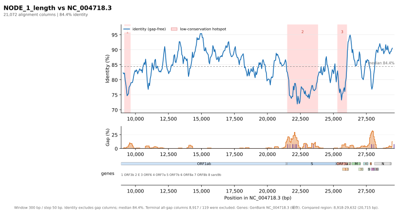

# align-conservation-plot

**中文** | [English](README.md)

从比对文件生成「滑窗一致度 + gap 密度 + 基因轨道」的出版级图，输出 **SVG / PDF / PNG**。
支持 EMBOSS `srspair` / `pair` 以及常见多序列比对格式，带 Tkinter GUI。



## 为什么自己写

现成工具都差一块：

| 工具 | 能力 | 缺口 |
|---|---|---|
| EMBOSS `plotcon` | 滑窗保守度曲线，可输出 pdf/svg | 画的是替换矩阵相似度分数，不是 identity%；无 gap 轨道、无 indel 标记、无基因轨道 |
| MSAexplorer | 多序列分析，读 gb/gff/bed，导 PDF | 无「按参考坐标的滑窗 identity + gap 密度」曲线；仅 PDF |
| pyMSAviz / MSAplot | MSA 色块图 + seqlogo | 不做滑窗 identity 曲线 |
| Jalview | 逐列保守度着色 | 不是按基因组坐标的滑窗图 |
| dna_features_viewer | 基因轨道 | 仅轨道 |

`srspair` 格式目前没有专门的可视化工具（GitHub 全站检索只在 janis-core 里找到 datatype 声明）。

## 安装

```bash
cd tools/alignment-conservation-plot
./setup.sh
```

脚本会优先使用 `/opt/homebrew/bin/python3.14`（自带 Tk 9.1），创建 `.venv` 并安装
`matplotlib` 与 `biopython`。若需要代理：

```bash
http_proxy=http://127.0.0.1:8080 https_proxy=http://127.0.0.1:8080 ./setup.sh
```

## 命令行

```bash
./.venv/bin/python align_conservation_plot.py \
    -i "examples/sars-cov-2-assembled-contig-vs-sars-cov.srspair" \
    -o figure.svg --pdf \
    --coords-seq 2 --window 300 --step 50 \
    --annotation NC_004718.3 \
    --title "SARS-CoV-2 contig vs SARS-CoV (NC_004718.3)"
```

输出：

```
figure.svg
figure.pdf
```

`--hotspot-table-md` 与 `--pdf-with-table` 的表格语言同样由 `--lang` 决定。

### 常用参数

| 参数 | 默认 | 说明 |
|---|---|---|
| `-i, --input` | 必填 | 比对文件（`.gz` 亦可） |
| `-o, --out` | `<input>_conservation.svg` | SVG 输出路径 |
| `--pdf [PATH]` | 关 | 同时输出 PDF |
| `--png [PATH]` | 关 | 同时输出 PNG（`--dpi` 控制分辨率） |
| `--coords-seq` | `1` | 用第几条序列做坐标轴（1-based）。与参考基因组比对时通常设为 `2` |
| `--window` / `--step` | `300` / `50` | 滑窗大小与步长（bp） |
| `--annotation` | 无 | 注释文件路径，**或 NCBI accession（如 `NC_004718.3`）** |
| `--annotation-timeout` | `60` | 在线下载超时（秒） |
| `--no-annotation-cache` | 关 | 不读也不写本地下载缓存 |
| `--refresh-annotation` | 关 | 忽略缓存，重新下载 |
| `--annotation-format` | 自动 | `genbank` / `gff3` / `tsv` |
| `--record` | 第一个 | GenBank 多记录时指定 record id |
| `--min-orf-aa` | `90` | 自动预测 ORF 的最短氨基酸长度 |
| `--indel-min` | `8` | 只报告 ≥ 该长度的 indel |
| `--hotspot-k` | `1.5` | 热点阈值 = median − k × 1.4826 × MAD |
| `--hotspot-pct` | 空 | 改用百分位阈值（优先于 `--hotspot-k`） |
| `--keep-terminal-gaps` | 关 | 保留两端全 gap 列（默认剔除） |
| `--lang` | `en` | 图内文字语言，`zh` 自动用 PingFang SC |
| `--stats-out` | 无 | 导出逐窗口统计 TSV |
| `--summary-out` | 无 | 导出 JSON 摘要 |
| `--hotspot-table-md` | 无 | 把低保守区表导出为 Markdown |
| `--pdf-with-table` | 关 | 把低保守区表追加到 PDF（图仍在第 1 页） |
| `--figsize W H` | 自动 | 图幅尺寸（英寸） |
| `--gui` | — | 启动图形界面 |

## 图形界面

```bash
./.venv/bin/python align_conservation_plot.py --gui
# 或双击 run_gui.command
```

- 左侧填写参数，右侧实时预览；
- 「注释文件或 accession」框可以直接填 `NC_004718.3`，联网下载（有缓存）；
- 右侧分「图 / 表」两个页签，表为低保守区一览（序号与图中编号一一对应）；
- 计算在后台线程执行，不阻塞界面；
- 导出时按标准图幅重新渲染，结果与窗口被拖成多大无关。

### 低保守区表

表格列：`序号`、`坐标 (bp)`、`长度 (bp)`、`一致度 % (不计gap)`、
`一致度 %（计gap）`、`插入或删除 %`、`所在区域`。

- 序号与图中热点编号严格一致；图会为**全部**热点编号。
- `所在区域` 取与热点重叠最长的注释特征；若有另一特征重叠 ≥ 热点长度 20%，
  以 `A / B` 并列；无注释时为 `—`。
- `插入或删除 %` 同时给两个数：`gap 列占比 / ≥阈值插入或删除事件覆盖比例`，
  例如 `3.7 / 0.0`。

### 批量导出

在「导出内容」里勾选需要的项目，点「一键导出…」选一次目录，按输入文件名批量落盘：

| 勾选项 | 产物 |
|---|---|
| 数据（TSV / JSON 可选） | `<stem>_windows.tsv` 或 `<stem>_summary.json` |
| 图 SVG | `<stem>_conservation.svg` |
| 图 PNG（DPI 可填 72–1200） | `<stem>_conservation.png` |
| 低保守区表 Markdown | `<stem>_hotspots.md` |
| PDF → 图 | `<stem>_conservation.pdf` 第 1 页 |
| PDF → 表 | 同一 PDF 的第 2 页起（表多时续页） |

PDF 的「图」「表」可同时勾选：都勾时写一个文件，图在第 1 页、表从第 2 页起；
只勾表则从第 1 页开始排表。

### 界面及图表语言

界面默认英文（`English`），左栏右上角的按钮可一键切换界面语言，只影响标签、按钮和对话框。

**所有图表输出——图内文字、表格页签的表头与表注、导出的 Markdown 与 PDF——统一由
「图表文字」单选项控制**，默认英文，与界面语言无关。切换该选项时表格会立即刷新。

**注意：点击「绘图」后切换图表文字语言不会重绘已有图，需要重新绘图；表格会立即更新。**

## 统计口径

- **一致度（不计 gap）** = matches / (matches + mismatches)，只在双方都有碱基的列上计算。
- **一致度（计 gap）** = matches / 所有列，gap 列计入分母。
- **gap 列**：至少有一条序列在该列为 gap 即计入（两序列时等价于「任一条为 gap」；
  多序列时不会因为总有人有碱基而恒为 0）。
- **插入或删除（indel）**：某条序列中连续 gap ≥ `--indel-min` 的区段；
  表中「插入或删除 %」为 `gap 列占比 / 该区段被 ≥阈值插入或删除事件覆盖的比例`。
- **多序列**：逐列统计「相同的序列对 / 有信息的序列对」，等价于平均两两一致度；
  因此「计 gap」的分母是 `列数 × 序列对数`，不是列数本身。
- **端部 gap**：所有序列都为 gap 的连续列，默认剔除并在页脚注明长度。
- **热点**：滑窗一致度低于 `median − k×1.4826×MAD`（或指定百分位）的窗口，合并为区间。
- 中文界面下统一使用「一致度 / 不计gap / 插入或删除」，对应英文
  identity / ungapped / indel。

## 在线注释（accession）

`--annotation` 除了本地文件，也可以直接填 NCBI accession，程序会自动下载：

```bash
./.venv/bin/python align_conservation_plot.py \
    -i aln.srspair -o fig.svg --coords-seq 2 \
    --annotation NC_004718.3
```

- 走 E-utilities `efetch`（`db=nuccore`, `rettype=gbwithparts`）。
- 下载结果缓存在 `~/Library/Caches/align-conservation-plot/<accession>.gb`
  （Linux `$XDG_CACHE_HOME`，Windows `%LOCALAPPDATA%`；可用环境变量
  `ALIGN_PLOT_CACHE` 覆盖）。用 `--refresh-annotation` 强制重下。
- 支持 `NCBI_API_KEY` / `NCBI_EMAIL` 环境变量（提高限速配额）。
- 需要代理时，`http_proxy` / `https_proxy` 会被自动沿用：

  ```bash
  http_proxy=http://127.0.0.1:8080 https_proxy=http://127.0.0.1:8080 \
    ./.venv/bin/python align_conservation_plot.py ... --annotation NC_004718.3
  ```

- 图例页脚会标注来源，例如 `GenBank NC_004718.3 (downloaded)` / `(cached)`；
  中文图表则显示 `(已下载)` / `(缓存)`。

## 注释文件

- **GenBank**（`.gb/.gbk/.genbank`）：取 `gene` / `CDS` / `mat_peptide` 等特征。
- **GFF3**（`.gff/.gff3`）：取 `gene` / `CDS` / `mRNA` 等，坐标按 1-based 闭区间解析。
- **TSV**：`name<TAB>start<TAB>end[<TAB>strand][<TAB>color]`，`#` 开头为注释。
- 不提供注释时，程序会对坐标参考序列做六框 ORF 预测（ATG 起始、贪心去重叠），
  并在页脚标注来源为 `predicted ORFs`。

## 输出示例

`examples/` 下有本仓库自带 srspair 的示例输出（见 [examples/README_zh.md](examples/README_zh.md)）。

## 已知限制

- `needle` 默认 `-gapextend 0.5` 会在高分歧区过度调用 1–2 bp 的小 gap；
  这些短 indel 不宜当作生物学信号，建议只看 ≥8 bp 的事件。
- 单条 contig 的低保守区也可能来自组装错误，最好用 reads 回贴验证覆盖度。
- 多序列的 identity 语义是「平均两两」，与「相对第一条序列」不同，图注已说明。
- GUI 不做缩放/平移，改参数后重新绘图即可。

## 许可证

本项目以 [BSD 3-Clause 许可证](LICENSE) 发布，
© 2026 alignment-conservation-plot 贡献者。

该许可证覆盖源代码。`examples/` 下的示例数据派生自公开数据来源，不在其覆盖
范围内，详见
[examples/README_zh.md](examples/README_zh.md#数据来源致谢与许可)。

## 目录

```
align_conservation_plot.py   # 全部逻辑：解析 / 统计 / 绘图 / CLI / GUI
requirements.txt             # matplotlib, biopython
setup.sh                     # 建 .venv 并安装依赖
run_gui.command              # macOS 双击启动 GUI
examples/                    # 示例输出（见 examples/README_zh.md）
```
